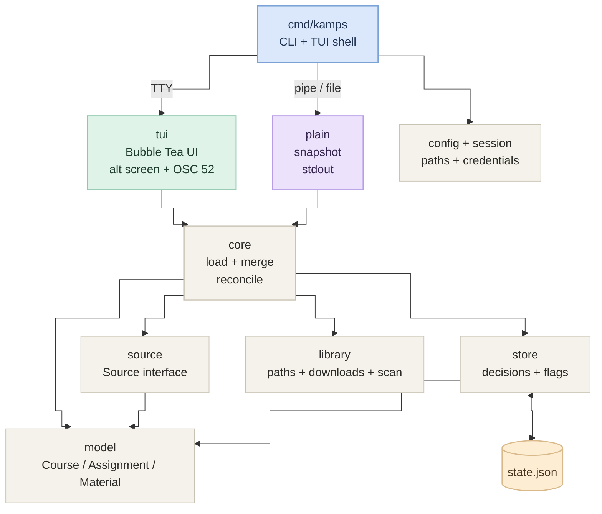

# Architecture & Package Structure

This document describes the architecture of Kamps, the responsibilities of each package, and the dependency boundaries that exist in the current codebase. It describes the build as it is, not the roadmap.

---

## 1. High-Level Architecture

Kamps separates **domain models**, **external data sources**, **persisted local state**, the **application core**, and the **terminal UI**.

The data boundary is simple:

- **LMS coursework data** is read-only external input received through [`source.Source`](../internal/source/source.go).
- **User decisions and local flags** are owned by the local machine and stored atomically in JSON via [`store.State`](../internal/store/store.go).
- The **application core** ([`core.Service`](../internal/core/core.go)) is the reconciler: it loads source data, resolves workspaces, overlays saved state, auto-triages submitted work, reconciles the library, and exposes a display-neutral snapshot.
- The **TUI** ([`tui.App`](../internal/tui/app.go)) renders that snapshot and captures user interaction. It also owns the per-run commit queue.
- The **commit queue** is intentionally not persisted. It is a per-run export buffer; decisions themselves are saved immediately.



There is no HTTP server, database, or daemon. Kamps is a single local binary.

---

## 2. Package Responsibilities

| Package | Path | Responsibility | Key Symbols |
|---|---|---|---|
| `main` | [`cmd/kamps`](../cmd/kamps/main.go) | CLI entry point, flag parsing, subcommands, TTY detection, runtime mode selection. | [`main()`](../cmd/kamps/main.go), [`isTTY()`](../cmd/kamps/main.go), [`printHelp()`](../cmd/kamps/main.go) |
| `config` | [`internal/config`](../internal/config/config.go) | Resolve XDG paths, load `config.toml`, provide the state/session/cache/lock paths. | [`Config`](../internal/config/config.go), [`Load()`](../internal/config/config.go), [`Config.StatePath()`](../internal/config/config.go) |
| `model` | [`internal/model`](../internal/model/model.go) | Pure domain types: courses, assignments, materials, triage, submission state. | [`Course`](../internal/model/model.go), [`Assignment`](../internal/model/model.go), [`Material`](../internal/model/model.go), [`Triage`](../internal/model/model.go) |
| `source` | [`internal/source`](../internal/source/source.go) | Source interface, registry, capabilities, and the bundled demo implementation. | [`Source`](../internal/source/source.go), [`Snapshot`](../internal/source/source.go), [`NewDemo()`](../internal/source/demo.go) |
| `kulon2` | [`internal/kulon2`](../internal/kulon2) | Live Moodle/Kulon2 session, course/activity parsing, and authenticated downloads. | `LiveSource`, `ParseCoursePage`, `ParseAssignmentPage`, `Download` |
| `store` | [`internal/store`](../internal/store/store.go) | Atomically persist triage, auto-triage, overrides, download records, and last sync. | [`State`](../internal/store/store.go), [`Load()`](../internal/store/store.go), [`Update()`](../internal/store/store.go) |
| `library` | [`internal/library`](../internal/library) | Safe material paths, resumable downloads, destination locks, and library scan. | `MaterialPath`, `DownloadFileWithOptions`, `Scan` |
| `cache` | [`internal/cache`](../internal/cache) | Last successful snapshot for offline startup. | `Save`, `Load` |
| `export` | [`internal/export`](../internal/export) | Markdown, todo.txt, and Taskwarrior render/write. | `For`, `Writer`, `Item` |
| `workspace` | [`internal/workspace`](../internal/workspace) | Discover and resolve `course.json` workspace mappings. | `Resolve` |
| `session` | [`internal/session`](../internal/session) | Private session file, expiry, save/load/delete. | `Session`, `Load`, `Save` |
| `core` | [`internal/core`](../internal/core) | UI-free application layer: load, workspace resolve, state merge, auto-triage, library reconcile, cache save/fallback. | [`Service`](../internal/core/core.go), `Load`, `LoadCached`, `Destination` |
| `api` | [`internal/api`](../internal/api/api.go) | Stable JSON DTOs and envelopes for headless commands. | `Envelope`, `Tasks`, `Materials`, `Courses` |
| `plain` | [`internal/plain`](../internal/plain/plain.go) | Non-interactive snapshot for pipes, files, and CI. Consumes `core`. | [`PrintPlain()`](../internal/plain/plain.go) |
| `tui` | [`internal/tui`](../internal/tui/app.go) | Bubble Tea rendering: tabs, trees, search, detail pane, styles, key dispatch. | [`App`](../internal/tui/app.go), [`New()`](../internal/tui/app.go) |
| `lockfile` | [`internal/lockfile`](../internal/lockfile) | Cross-platform advisory locks for state and destinations. | `Acquire`, `Unlock` |
| `browsercookie` | [`internal/browsercookie`](../internal/browsercookie) | Browser profile cookie extraction for `login --browser`. | `Find` |
| `format` | [`internal/format`](../internal/format/format.go) | Shared byte-size formatting and assignment ordering. | [`HumanSize()`](../internal/format/format.go), [`SortAssignments()`](../internal/format/format.go) |

### TUI file map

| File | Responsibility |
|---|---|
| [`app.go`](../internal/tui/app.go) | Root model, tabs, messages, `Update`, app construction |
| [`keys.go`](../internal/tui/keys.go) | Key bindings, key dispatch, `?` overlay data |
| [`navigation.go`](../internal/tui/navigation.go) | Tab switching, cursors, folding, selection |
| [`filters.go`](../internal/tui/filters.go) | Filter names, cycling, clearing |
| [`tasks.go`](../internal/tui/tasks.go) | Task filtering, target resolution, triage, task footer |
| [`task_tree.go`](../internal/tui/task_tree.go) | Flattened task hierarchy and grouping |
| [`task_rows.go`](../internal/tui/task_rows.go) | Task rows, counts, totals, Tasks tab body |
| [`detail_tasks.go`](../internal/tui/detail_tasks.go) | Task detail content |
| [`materials.go`](../internal/tui/materials.go) | Material filtering, tree data, downloads, attachment links |
| [`material_rows.go`](../internal/tui/material_rows.go) | Material rows and Materials tab body |
| [`detail_materials.go`](../internal/tui/detail_materials.go) | Material detail content |
| [`commit.go`](../internal/tui/commit.go) | Session queue, preview, clipboard, Commit tab |
| [`sync.go`](../internal/tui/sync.go) | Real reload, cursor restoration, session status, Sync tab |
| [`chrome.go`](../internal/tui/chrome.go) | Shell, tab bar, footer, help overlay |
| [`detail.go`](../internal/tui/detail.go) | Split-pane visibility, widths, clipping |
| [`search.go`](../internal/tui/search.go) | Search state, title, predicates, search-mode keys |
| [`state.go`](../internal/tui/state.go) | App-to-core state bridge |
| [`cache.go`](../internal/tui/cache.go) | Cache-first startup through `core.LoadCached` |
| [`tree.go`](../internal/tui/tree.go) | Shared node contract, fold keys, indentation |
| [`frame.go`](../internal/tui/frame.go) | Title line, body clamping, tab cells, rules, footer hints |
| [`row.go`](../internal/tui/row.go) | Cursor/mark bands, gutters, carets, selection cells |
| [`theme.go`](../internal/tui/theme.go) | Semantic color tokens and reusable Lip Gloss styles |
| [`text.go`](../internal/tui/text.go) | Width, padding, truncation, wrapping |
| [`window.go`](../internal/tui/window.go) | Viewport windows and scroll hints |
| [`format.go`](../internal/tui/format.go) | Shared formatting helpers such as `taskLine`, `shortCode`, `lastSyncLine` |
| [`numbers.go`](../internal/tui/numbers.go) | Small integer helpers |

---

## 3. Verified Dependencies & Ecosystem Usage

From [`go.mod`](../go.mod) and direct code imports:

### Direct Dependencies

1. **`github.com/charmbracelet/bubbletea` (v1.3.10)**
   - Used for the core event loop: [`tea.Model`](../internal/tui/app.go), [`tea.Msg`](../internal/tui/app.go), [`tea.Cmd`](../internal/tui/app.go), and [`tea.NewProgram`](../cmd/kamps/main.go).
   - Kamps runs the interactive UI in the alternate screen (`tea.WithAltScreen()`), then restores the shell on exit.
   - Manages terminal setup, key listeners, window resize events, and spinner ticks.

2. **`github.com/charmbracelet/bubbles` (v1.0.0)**
   - [`spinner.Model`](../internal/tui/app.go) drives the sync indicator while `s` reloads the source.
   - [`help.Model`](../internal/tui/app.go) and [`key.Binding`](../internal/tui/keys.go) provide the `?` help overlay.

3. **`github.com/charmbracelet/lipgloss` (v1.1.0)**
   - Declarative style engine for terminal rendering.
   - Provides [`lipgloss.AdaptiveColor`](../internal/tui/theme.go) for light/dark terminals and width measurement used throughout the layout.

4. **`github.com/charmbracelet/x/term` (v0.2.2)**
   - Used by [`isTTY`](../cmd/kamps/main.go) via `xterm.IsTerminal` to choose between the TUI and plain mode.

### Auxiliary / Indirect Libraries

- **`github.com/charmbracelet/x/ansi`**
  - Used by [`ansiTruncate`](../internal/tui/text.go) and tree rows to truncate styled strings without cutting ANSI escapes or multi-byte runes.

---

## 4. The Data Separation Boundary

```
[ LMS platform (Moodle / Kulon2) or demo data ]
                    │
                    │ read-only
                    ▼
          source.Source
                    │
                    ▼
    []model.Course / Assignment / Material
                    │
                    │ overlay local decisions
                    ▼
       store.State.Apply() ◄── $XDG_STATE_HOME/kamps/state.json
                    │
                    ▼
       TUI trees, detail pane, commit preview
```

1. **Source data is read-only in practice:** [`source.Source`](../internal/source/source.go) exposes `Label` and `Load`. `Load` returns one [`source.Snapshot`](../internal/source/source.go) with courses, assignments, and materials, and the demo returns copies of its slices so UI mutations cannot corrupt the dataset.
2. **Saved state is an overlay:** when a decision exists in the store, [`store.State.Apply`](../internal/store/store.go) writes it over the source value. If there is no stored entry, the source's `Triage` value remains. Real sources should therefore return `Undecided`; the demo deliberately seeds a few states to make its screens realistic.
3. **Undecided deletes the entry:** storing `Undecided` removes the decision instead of writing noise.
4. **Atomic writes:** decisions are saved immediately through a temporary file in the same directory, `Sync()`, `chmod 0600`, and an atomic rename.
5. **The queue is not state:** `App.pending` tracks what this run would export. `x` drops an item from the queue without reverting the stored decision.

### Load-time behavior

- A **missing** `state.json` is not an error; Kamps starts empty.
- A **corrupt** file returns an error. `tui.New` keeps an empty state, and the first `loadedMsg` shows a footer warning. Kamps does not overwrite the corrupt file until the next successful save.
- Unknown or zero triage values are dropped while loading.
- Download flags are applied only when true; absent means not downloaded.

### Plain mode

[`plain.PrintPlain`](../internal/plain/plain.go) consumes the same [`core.Service`](../internal/core/core.go) as the TUI, with no Bubble Tea loop:

1. Call `Service.Load` synchronously.
2. On a source error, try `Service.LoadCached`; if no cache exists, return the source error.
3. Sort assignments by due date (dated first, oldest first, then ID).
4. Print a plain-text snapshot, including the cache time when offline.

A corrupt state file is still skipped, matching the TUI's best-effort behavior.

---

## 5. TUI Composition

### Shell

The interactive screen is borderless. The top tab bar, title line, body, and footer are separated by full-width rules rather than boxes. This leaves every column for content and keeps the split pane from sitting between two borders.

- Minimum comfortable size: 80 columns × 24 rows. Below that, Kamps renders a short “terminal too small” notice.
- Header: tab names with live counts and a status label.
- Title row: current filter or search query, match/total counts, scroll hint.
- Body: the active tab's rows, clamped to the available height.
- Footer: key hints on the left, queue/toast on the right.

### Trees

Both tree tabs render a flat `[]node` list. [`node`](../internal/tui/tree.go) stores its kind, depth via `parents`, a stable fold key, and the underlying assignment or material. The cursor is an index into the same list, so a highlight always corresponds to the row the keys will act on.

- **Tasks:** course → state bucket (`needs decision`, `tracked`, `closed`) → task → attached materials.
- **Materials:** course → week → folder → file → linked assignment (for attachments). Downloaded files carry a ● marker.
- **Folding:** tasks keep `needs decision` open; tracked/closed and material weeks/folders start collapsed. Each tab keeps its own fold state.
- **Right padding:** both trees keep a two-column inset so metadata does not touch the divider or terminal edge.

### Search and filters

- `/` is search, not a view toggle. It is available on Tasks and Materials.
- Search is live, case-insensitive, and trims the query before matching.
- Tasks match name, ID, goal, and course name/code/short label.
- Materials match name, ID, section, kind, course code, and course name/code/short label.
- `f` cycles the tab's state filter; search and filter compose.
- Switching tabs clears the search and restores that tab's filter.
- `esc` clears the search first, then the filter, then selections/back.

### Detail pane

- Visible on Tasks and Materials only.
- Opt-in: `enter` opens or closes it; it follows the cursor while open.
- Split: 62% tree / remaining detail, with a 24-column minimum for detail.
- Long descriptions wrap; clipped detail content ends with `…`.

### Commit queue

- `t`, `m`, `i`, `u` update in-memory assignments, store the decision, and add/remove the item in `App.pending`.
- `c` opens the Commit tab; `esc` returns to the previous tab.
- The preview groups items by action and shows the exact task lines.
- `y` (or `enter`) copies the preview with OSC 52; `x` removes the focused item from the queue only.
- The queue is session-only. Restarting Kamps keeps decisions but starts an empty queue.

---

## 6. Known Seams

These are current limitations, not mysteries:

- **Config supports the runtime surface.** Site URL, library directory, source selection, workspace roots, commit target/format, and auto-triage are implemented.
- **The live source covers current modules.** It verifies the session, fetches courses and course pages, reads due dates/submission state, materializes assignment attachments and folder children, and downloads files with session authentication.
- **The demo source seeds triage values.** They are useful for screenshots but are not user state; live sources return source data and let the store/auto-triage decide.
- **Downloads transfer bytes, resume, and retry.** Partial `.part` files survive cancellation; Range requests continue them; rate limits and 5xx responses back off.
- **Sync reloads the source.** `s` preserves the tab, cursors, search, and selection; a failed load falls back to the cached snapshot.
- **Exporters write files or Taskwarrior.** Markdown, todo.txt, and Taskwarrior are idempotent; the clipboard remains available with `y`.
- **`similarManualTask` is a demo stand-in** for a future working-directory cross-check and is not part of exported output.
