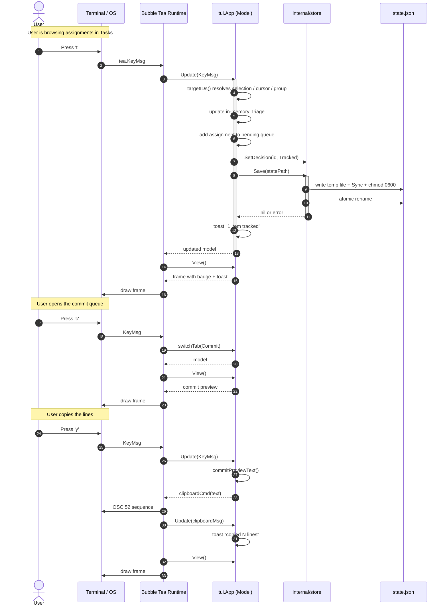

# Execution Flow & Runtime Lifecycle

This guide traces the runtime execution of Kamps from binary invocation to shutdown. It covers mode selection, asynchronous data loading, keyboard event processing, atomic state persistence, and rendering.

---

## 1. Application Lifecycle

```
                    ┌─────────────────────────┐
                    │    ./kamps execution    │
                    └────────────┬────────────┘
                                 │
                     Parse --no-anim / version / help
                     config.Load()
                     source.NewDemo() or kulon2.NewSource()
                                 │
                       isTTY(os.Stdout)?
                                 │
               ┌─────────────────┴─────────────────┐
       No (pipe / file)                    Yes (interactive)
               │                                   │
       plain.PrintPlain()                 tea.NewProgram()
   synchronous stdout snapshot             tea.WithAltScreen()
               │                                   │
             Exit                            tea.Model loop
                                            Init() ──▶ Update() ──▶ View()
                                                   │
                                             tea.Quit (q / ctrl+c)
                                                   │
                                             restore terminal
```

---

## 2. Step-by-Step Flow

### Step 1: Startup & Mode Selection

- **Entry point:** [`main()`](../cmd/kamps/main.go) in `cmd/kamps/main.go`.
- Arguments are scanned for `--no-anim` / `--noanim`. Remaining arguments are checked for `version`/`--version`/`-v` and `help`/`--help`/`-h`.
- Configuration is loaded via [`config.Load()`](../internal/config/config.go), layering `config.toml` over defaults. It resolves:
  - `$XDG_STATE_HOME/kamps/state.json` and `session.json` (or `~/.local/state/kamps/`)
  - `$XDG_CONFIG_HOME/kamps/config.toml` (or `~/.config/kamps/config.toml`)
  - `~/Documents/kamps` as the download-library default
- `kamps login` verifies a manually pasted MoodleSession cookie; `kamps logout` removes it.
- `--demo` selects [`source.NewDemo()`](../internal/source/demo.go); otherwise `kulon2.NewSource()` requires a saved session and loads the live course list.
- **TTY check:** [`isTTY(os.Stdout)`](../cmd/kamps/main.go) uses `xterm.IsTerminal`:
  - **Non-TTY:** [`plain.PrintPlain()`](../internal/plain/plain.go) runs synchronously, prints a plain-text snapshot, and exits.
  - **TTY:** [`tui.New(src, cfg, version)`](../internal/tui/app.go) constructs the root model and `tea.NewProgram` starts it with `tea.WithAltScreen()`.

### Step 2: Model Construction & State Load

[`tui.New`](../internal/tui/app.go) prepares the app before any source data arrives:

1. Creates the spinner and help model.
2. Creates an empty [`store.State`](../internal/store/store.go).
3. Resolves `cfg.StatePath()`.
4. Calls [`store.Load`](../internal/store/store.go) when a path exists.
   - Missing file: clean empty state.
   - Corrupt file: keeps empty state and remembers the error in `stateErr`.
   - Valid file: keeps the loaded decisions and downloads.
5. Initializes tabs, filters, expansion maps, selections, and the session-only `pending` queue.

### Step 3: Initialization & Async Data Loading

- Bubble Tea calls [`App.Init()`](../internal/tui/app.go), which returns [`loadCmd(m.src)`](../internal/tui/app.go).
- Bubble Tea runs this command in a goroutine, so the UI remains responsive.
- Inside `loadCmd`, one source call returns the snapshot:
  1. `src.Load(ctx)` returns courses, assignments, and materials for Demo.
  2. Live Kulon2 mode returns courses, assignments, resources, assignment attachments, and folder children; per-page failures append a `Snapshot.Notice` instead of hiding the whole snapshot.
- Any error returns [`errMsg`](../internal/tui/app.go).
- On success, it returns [`loadedMsg`](../internal/tui/app.go) with the snapshot.

While loading, `View` renders `loading…`. If loading fails, the body shows `error · …`. A partial snapshot notice is shown above the available data.

### Step 4: State Reapplication

When `loadedMsg` arrives in [`App.Update`](../internal/tui/app.go):

1. `loaded` becomes true and `loadError` is cleared.
2. Courses and materials are stored and sorted:
   - Courses by `Name`.
   - Materials by course code, then section, then name.
   - Assignments are left in source order here; the visible Tasks list sorts them later.
3. [`App.applyState()`](../internal/tui/state.go) calls [`store.State.Apply`](../internal/store/store.go), overlaying saved decisions and download flags.
4. [`App.clampCursor()`](../internal/tui/navigation.go) keeps every tab cursor inside its current row list.
5. If state loading failed earlier, a footer toast reports it once.

### Step 5: Keyboard Event Loop

Every keystroke arrives as a `tea.KeyMsg` and goes through [`App.handleKey`](../internal/tui/keys.go) in this order:

1. **Help overlay (`?`):** only `?`, `esc`, `q`, and `ctrl+c` are handled; everything else is swallowed until it closes.
2. **Search mode:** while `m.searching`, all keys go to [`handleSearchKey`](../internal/tui/search.go).
3. **Normal mode:** the main key switch.

#### Search mode

- Printable runes and space append to the query.
- `backspace` / `ctrl+h` delete one rune.
- `ctrl+w`, `alt+backspace`, and `ctrl+backspace` delete the last word, readline-style.
- `ctrl+u` clears the query.
- `↑`/`ctrl+p` and `↓`/`ctrl+n` move the result cursor.
- `enter` leaves search mode but keeps the query.
- `esc` leaves search mode and clears the query.
- `tab` / `shift+tab` switch tabs; `switchTab` clears search.
- The query cursor is always at the end; there is no left/right cursor movement inside the query.

#### Normal mode

| Key | Action |
|---|---|
| `q`, `ctrl+c` | Quit |
| `?` | Open help overlay |
| `tab`, `shift+tab` | Next / previous tab |
| `1`–`4` | Jump to Tasks, Materials, Sync, Commit |
| `↑`/`k`, `↓`/`j` | Move cursor |
| `←`/`h`, `→`/`l` | Fold / open the focused container; on a folded leaf, move to parent |
| `space` | Select the focused row |
| `a` | Select all |
| `t`, `m`, `i`, `n` | Apply triage (Tasks only; `n` = undecided) |
| `u` | Undo the last triage batch |
| `:` / `ctrl+k` | Open the command palette |
| `c` | Open Commit tab |
| `esc` | Close Commit; otherwise clear search, then filter, then selections/back |
| `enter` | Toggle detail on Tasks/Materials; copy preview on Commit |
| `f` | Cycle the tab's filter |
| `/` | Start search on Tasks/Materials |
| `s` | Reload the source and reconcile local state |
| `d` | Mark Materials as downloaded |
| `y` | Copy the commit preview (Commit only) |
| `x` | Drop the focused item from the queue (Commit only) |

`switchTab` saves the current tab's filter and expansion map, restores the next tab's, and clears the search. The detail-pane override is global, not per tab.

### Step 6: Persistence Flow

#### Triage

[`App.applyTriage(t)`](../internal/tui/tasks.go) only acts on the Tasks tab:

1. [`targetIDs()`](../internal/tui/tasks.go) resolves targets in this order:
   - checked assignments, if any;
   - the focused assignment;
   - all visible children when the cursor is on a group row.
2. Each target's in-memory `Triage` is updated.
3. [`State.SetDecision(id, t)`](../internal/store/store.go) updates the persisted map. `Undecided` deletes the entry.
4. The item is added to or removed from the session-only `pending` queue.
5. Selections are cleared and a toast is shown.
6. The state bridge in [`state.go`](../internal/tui/state.go) persists the change and reports failures to the UI.

#### Downloads

[`App.download()`](../internal/tui/materials.go) only acts on Materials. It prefers checked files; with no selection it uses the focused file, week, folder, or course row. Files are streamed by the source's `Download` method into `<library_dir>/<course>/<week>/<folder>/<filename>` as a `tea.Cmd`; on completion the material is marked `Downloaded`, recorded in the store, and saved. External links are not downloaded: `o` opens them in the browser. Demo mode has no downloader and keeps the flag-only behaviour.

#### Commit queue

- `commitItems()` joins `pending` with the current assignments and sorts by action, then ID.
- `commitPreviewText()` renders the exact Markdown task lines.
- `w` writes the preview; `y` copies it through OSC 52. `enter` writes when a target is configured or copies otherwise.
- `x` deletes the item from `pending` only; the assignment's stored decision is unchanged.
- Restarting Kamps restores decisions and downloads, but not the queue.

#### Atomic state writing

[`store.State.Save`](../internal/store/store.go):

1. Sets the current schema version.
2. Marshals indented JSON with a trailing newline.
3. Creates the state directory (`0755` if missing).
4. Writes a temporary `.state-*.json` file in the same directory.
5. Calls `Sync()`.
6. Sets the temporary file to `0600`.
7. Renames it over `state.json`.

A crash mid-write leaves either the old file or the new file, never a half-written one.

### Step 7: Rendering Pipeline

[`App.View()`](../internal/tui/chrome.go) composes a fixed shell:

1. Defaults width/height to 100×30 if unknown, then clamps to at least 1.
2. Calls `tabContent(width, height-5)` to get the title, right-hand status, footer hints, and body rows.
3. Replaces the body with an error or `loading…` message when appropriate.
4. Replaces the whole content area with the help overlay when `?` is open.
5. Shows a terminal-size notice below 40 columns or 10 rows.
6. Emits:
   - tab bar (1 row)
   - title line (1 row)
   - rule (1 row)
   - body (`height-5` rows)
   - rule (1 row)
   - footer (1 row)

#### Tab bodies

- **Tasks:** the list presents an attention shortlist, overdue work, and course groups. Filters and search restrict the visible tasks.
- **Materials:** the all-courses view groups files by week and course. A selected course shows its own weeks.
- **Sync:** `s` reloads the source and reports the result.
- **Commit:** groups pending items by action, shows task lines, overdue warnings, and the demo `similarManualTask` hint.

#### Detail pane

- `detailVisible()` returns false outside Tasks/Materials.
- The inspector is closed until opened.
- `enter` toggles `detailPane` between pinned closed (`0`) and pinned open (`1`).
- At 140 columns and 24 rows, `splitWidths` allocates 62% to the content and the rest to detail. At smaller sizes, detail replaces the content.
- `detailRows` clips content to the pane height and marks the final clipped line with `…`.

#### Footer

[`helpBar`](../internal/tui/chrome.go) is the single footer path:

- Search mode shows search keys.
- Tasks uses `taskFooter`, which preserves the queue/toast on the right and drops hints that no longer fit.
- Other tabs use `hints` with a right-aligned queue label.
- A toast replaces the queue label while it is visible. Toast lifetime is driven by `spinner.TickMsg`; with `--no-anim`, the sync animation finishes in one tick, while toasts still expire on later ticks.
- This unification is why toasts are visible on every tab.

---

## 3. Representative Sequence: Triage and Clipboard Export

This traces a complete user flow: mark an assignment **Tracked** (`t`), open the **Commit** tab (`c`), and copy the preview (`y`).



---

## 4. Plain Mode

When stdout is not a terminal, [`PrintPlain`](../internal/plain/plain.go) bypasses Bubble Tea entirely:

1. Calls `src.Load(ctx)` once and returns immediately on a source error.
2. If `cfg.StatePath()` is set, loads state and applies decisions/downloads.
3. Sorts assignments by due date, then ID.
4. Prints:
   - source label and counts;
   - assignment rows with flag, due date, course, state, and name;
   - material rows with section, local/new state, name, and size.

It emits no ANSI and no animation. Source errors are returned to the CLI, which prints them to stderr and exits non-zero; a corrupt state file is still skipped.
